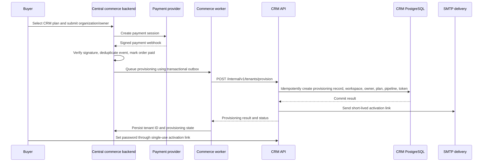

# Central commerce → CRM provisioning contract

## Ownership and flow

The central commerce service owns products, checkout, orders, provider webhooks,
payment records, and cross-product onboarding. CRM owns organizations, CRM
users and memberships, subscription enforcement, CRM defaults, and tenant data.
The caller must verify the payment provider event before it asks CRM to
provision. A browser redirect is never payment evidence.



CRM uses a shared PostgreSQL database with `organization_id` on tenant-owned
records. Tenant identity continues to come from the authenticated server-side
session and verified membership. The new `organizations.slug` is metadata; the
existing CRM routes still select workspaces through verified membership and an
organization selector, not a public slug URL.

## Provisioning request

`POST /internal/v1/tenants/provision`

Headers:

```http
Authorization: Bearer <CRM_PROVISIONING_TOKEN>
Idempotency-Key: order_01JXYZ_crm_provision
Content-Type: application/json
```

```json
{
  "requestId": "prov_01JABC",
  "orderId": "ord_01JXYZ",
  "product": "crm",
  "plan": {
    "code": "growth",
    "billingInterval": 30,
    "currency": "INR",
    "amountMinor": 249900
  },
  "organization": {
    "name": "Acme Solutions",
    "slug": "acme-solutions",
    "timezone": "Asia/Kolkata"
  },
  "owner": { "name": "Aarav Sharma", "email": "owner@example.com" }
}
```

CRM matches plan code, billing interval, currency, and paise amount to its
active server-side plan. The caller cannot select an owner role, price,
entitlements, or enabled modules. CRM derives modules and seat limits from the
selected plan. The first user is always an Owner, initially pending until
activation. `201 Created` returns `requestId`, `status: SUCCEEDED`, tenant ID,
slug and login URL, owner ID with `activationRequired: true`, subscription
status and `activationEmailSent`. Repeating the exact request with the same
key/order/request IDs returns the stored result. Reusing an identifier with
different values returns `409 IDEMPOTENCY_CONFLICT`.

Expected errors include `401 service_auth_failed`, `503
provisioning_unavailable`, `400 validation_error`, `400 PLAN_NOT_FOUND`,
`409 OWNER_EMAIL_EXISTS`, and `409 IDEMPOTENCY_CONFLICT`. Slug conflicts are
currently surfaced through the database uniqueness error and need a structured
`SLUG_TAKEN` mapping before the central caller can offer a dedicated recovery
flow.

## Status and email retry

- `GET /internal/v1/provisioning/{requestId}` returns the stored state and IDs.
- `POST /internal/v1/provisioning/{requestId}/activation-email/retry` issues a
  new one-hour token and retries delivery without creating another workspace.
- Both require the same service bearer credential.
- Platform admins can inspect recent records at
  `GET /api/v1/control-panel/provisioning-requests`.

Activation links point to `/activate-account?token=...`. The CRM stores only a
SHA-256 digest, expires the token after one hour, consumes it once, activates
the pending Owner membership, and sets the password. Passwords are never sent
by email.

## Persistence and rollout

Migration `20261115120000_crm_provisioning` is additive. It adds an idempotent
provisioning request ledger, activation token purpose, optional organization
slug, and timezone. Existing signups and control-panel onboarding keep their
existing behaviors; the default sales pipeline definition is shared with the
new provisioning domain service.

Set `CRM_PROVISIONING_TOKEN` to a long random secret in the CRM secret manager
and the matching central backend secret store. The CRM endpoint is rate limited
and excluded from browser cookie authentication/organization context. Restrict
network access to the commerce worker where deployment allows it, rotate the
credential, and never put it in a browser or `NEXT_PUBLIC_*` variable.

## Current boundary / remaining integration

This workspace contains only the CRM application. Central product catalogue,
customer orders, payment-provider webhook verification, immutable payment
ledger, transactional outbox/queue, central order/admin UI, and end-to-end
commerce integration tests must be implemented in the central commerce
repository. Refund, chargeback, suspension, and recurring-renewal policies
also remain business decisions before production rollout. Do not call CRM
provisioning until central payment state is verified.
